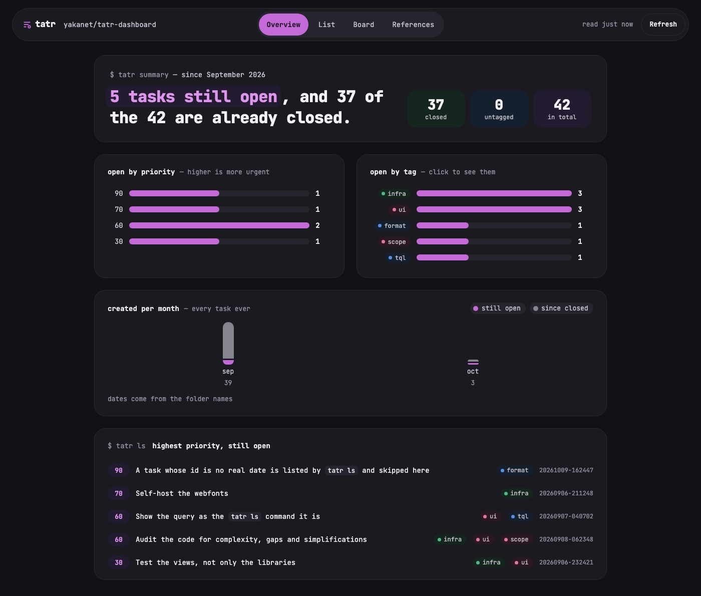
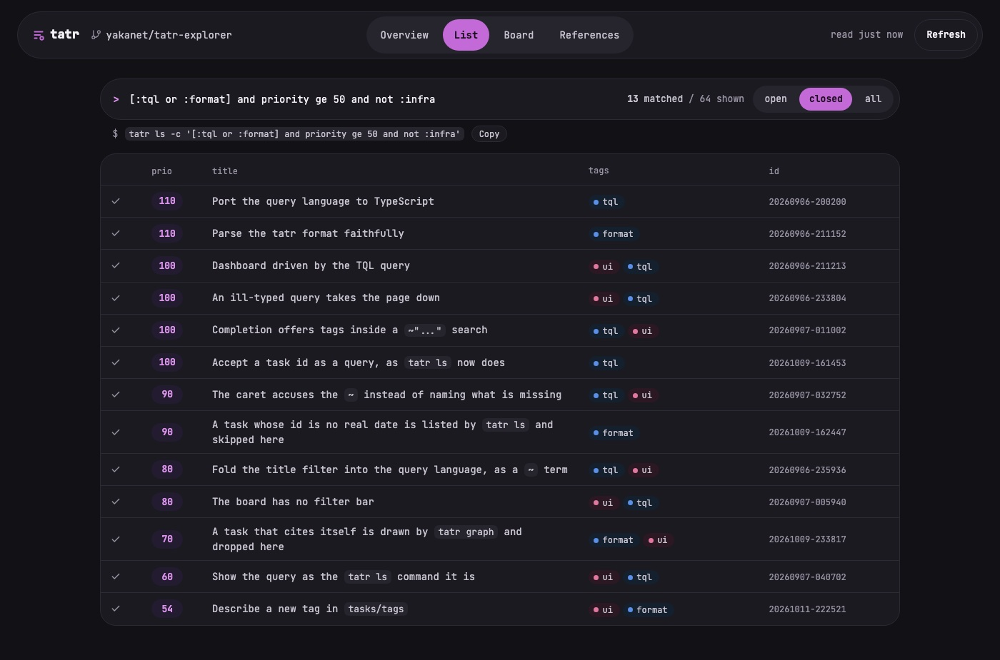
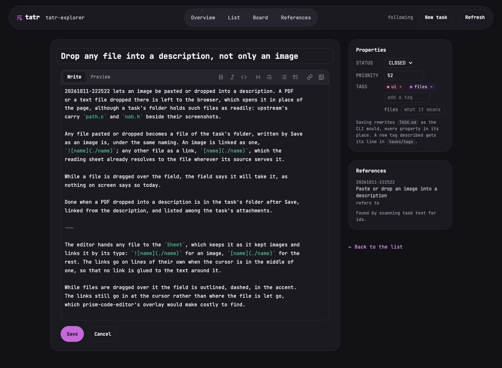

<div align="center">

# tatr explorer

**Any repository's `tasks/` folder, read like an issue tracker.**<br>
In the browser. No server, no backend, no clone.

[**Open it →**](https://github.broutin.dev/tatr-explorer) &nbsp;·&nbsp;
[Watch it read its own backlog](https://github.broutin.dev/tatr-explorer/yakanet/tatr-explorer) &nbsp;·&nbsp;
[What is tatr?](https://github.com/tsoding/tatr)

[](https://github.com/yakanet/tatr-explorer/actions/workflows/deploy.yml)

</div>



<div align="center"><sub>Reading <a href="https://github.com/yakanet/tatr-explorer"><code>yakanet/tatr-explorer</code></a>, this repository, which tracks its own work with tatr.</sub></div>

## Try it

Nothing to install: [open it](https://github.broutin.dev/tatr-explorer) and
paste a repository name. To run it on your machine, with
[pnpm](https://pnpm.io):

```shell
git clone https://github.com/yakanet/tatr-explorer.git
cd tatr-explorer
pnpm install
pnpm run dev                              # then open a repository, or a folder
TATR_FOLDER=../my-project pnpm run dev    # or serve a project's tasks
```

The second form serves that folder at `/served`, which any browser can
[edit](#edit-where-the-folder-can-be-written). [Develop](#develop) has the
checks and the build.

## What it does

[tatr](https://github.com/tsoding/tatr) keeps each task as a folder of Markdown
(`tasks/20260315-160715/TASK.md`), versioned with the code. tatr explorer shows
that folder as an overview, a list, a board and a graph of the tasks that cite
each other: paste a repository name, or open a folder on your machine.

|                         | GitHub          | Local folder                                                              | Dev server, `/served` |
| ----------------------- | --------------- | ------------------------------------------------------------------------- | --------------------- |
| Reads tasks             | ✓               | ✓                                                                         | ✓                     |
| Edits tasks             | ✗               | Chromium: ✓<br>Firefox, Safari: ✗                                         | ✓                     |
| Follows your changes    | manual refresh  | Chromium: ✓<br>Firefox, Safari: ✓ if the folder was dragged onto the page | ✓                     |
| Branches to choose from | ✓               | ✗                                                                         | ✗                     |
| Costs                   | GitHub requests | nothing                                                                   | nothing               |

> [!WARNING]
> A local folder has to be opened again after each reload: the browser takes
> its access back.

## A companion to the CLI

Browse your tasks with TQL, the query syntax `tatr ls` accepts: a query from
your shell history gives the same answer here.

| Query                              | Matches                             |
| ---------------------------------- | ----------------------------------- |
| `:ui`                              | tasks tagged `ui`                   |
| `not :scope`                       | everything nobody is working on     |
| `[:ui or :tql] and priority ge 90` | brackets group, so no shell quoting |
| `~"query language"`                | titles holding all those words      |

> [!NOTE]
> `~` is this viewer's own addition: `tatr ls` cannot search titles, so a query
> that uses it will not run in the CLI. Every other query behaves the same in
> both.

Queries, the file format, the reference graph and every file this site writes
are tested against the real `tatr`, over the 79 tasks of `tsoding/tatr` and a
corpus of edge cases:

```shell
pnpm run fixtures   # runs the real tatr, built in ../tatr, and records what it prints and writes
pnpm test           # replays every recording against this viewer: a divergence fails
```



## Edit, where the folder can be written

- **The board**: drag a card to Done, In progress or Backlog, and its file says
  so.
- **Edit** a task: its title, its description in a Markdown editor with a
  preview, its status, priority and tags.
- **New task**, or `n`: the file `tatr new` writes, byte for byte.
- **A new tag** gets a description field, appended to `tasks/tags`.
- **Paste or drop** an image or any file into the description: it lands in the
  task's folder.

Save writes only what you changed, and never over a change it did not read. A
file is rewritten as `tatr untag` rewrites one, so a file the CLI wrote comes
back byte for byte. Undo puts the task's file back.



## Private by construction

No account, no cookie, no analytics: there is no server, and what you read stays
in your browser.

- **Only task metadata is cached**, in your browser's IndexedDB, and read again
  only when you press Refresh.
- **GitHub's budget is spared**: one request lists a whole repository, contents
  come from its CDN, which does not count, and `ungh.cc` is asked only once the
  budget is spent.

## Develop

```shell
pnpm run check                            # svelte-check, kept at zero errors
pnpm test                                 # the specs, beside the code as *.spec.ts
BASE_PATH=/tatr-explorer pnpm run build   # what CI builds; a push to main deploys it
```

Built with SvelteKit 3, Svelte 5 runes, Vite 8, markdown-it and Vitest. What the
specs share lives in `tests/`: recordings in `tests/fixtures/`, fakes in
`tests/support/`.

**Adding a source** takes a class implementing `Source`
(`src/lib/sources/contract.ts`), the capabilities it really has
(`capabilities.ts`: `Cached`, `Rereadable`, `Followable`, `Branched`, `Linked`,
`Writable`), and one line in `SOURCES` (`open.ts`). The compiler asks for the
rest, and `contract.spec.ts` runs it through the tests every source passes.

## Credits

This repository tracks its own work with tatr:
[here is its backlog](https://github.broutin.dev/tatr-explorer/yakanet/tatr-explorer/list).

The format, the CLI and the query language are
[tsoding's](https://github.com/tsoding/tatr). MIT licensed: see
[LICENSE](LICENSE), except the recordings of `tsoding/tatr`, which carry
upstream's task text (see [`NOTICE`](NOTICE)).
